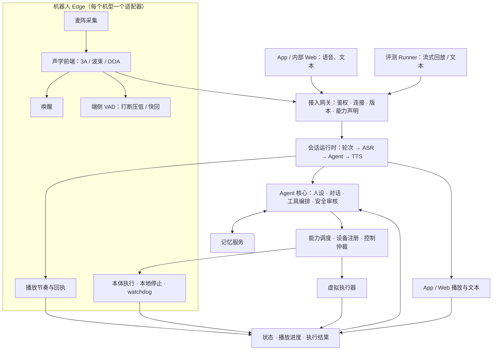

# 机器人云端 Agent OS 产品需求与架构总纲（Bumi 首发）

版本：v2.1 定稿，2026-11-01。

本文是 bumi-agent、Bumi_Mem、Bumi-Eval、bumi-avfe 及 App 对接接口的统一需求依据，约束设计、实现、重构和验收；各仓的实施任务书与接口契约负责细化，与本文冲突时以本文为准，先对齐再实施。需求变更由管理者决定并先改本文。本文描述需求与验收边界，不代表能力已实现。

访问说明：本文公开维护；引用的部分实现仓库和内部知识库规范需要组织访问权限。引用保留用于组织内追溯，不表示这些资料已公开。

## 1. 目标与范围

同一个 Bumi 可通过机器人本体、手机 App 或 Web 与用户交互；机器人离线时仍可经手机使用；Agent 的自我认知始终是机器人人设。

平台与机型解耦：该 Agent OS 后期服务 Bumi 以外的机器人。Bumi 是第一个接入的机型与角色，新机型通过「机型档案 + Edge 适配器」接入（第 4 节），不修改云端核心、协议与评测框架。

硬约束：单台月推理成本；首响（说完到出声）p50 ~800ms、p95 <1.5s；打断响应 <300ms；儿童与家庭隐私。口径见[《指标·时延·成本·端云》技术基线所在导航页](https://noetixrobotics.feishu.cn/wiki/YNTEwrqY1igjxCkVFW9c4m5wndc)（需组织访问权限）。验收时须注明测量条件：日活轮次 / 时长、并发、网络、模型、冷热启动、机型。成本目前是估算框架，单台月成本上限待定（第 19 节）。

产品入口两类：机器人对话；App 或 Web 对话。内部 Web 用于体验、联调和评测；正式 App 由其他团队开发，通过公开接口接入。手机输入首版做语音、文本，预留图片、视频；输出以语音、文本为主。

| 使用方式 | 输入 | 回答输出 | 身体执行 |
| --- | --- | --- | --- |
| 直接跟机器人聊 | 机器人麦克风 | 机器人扬声器 | 当前 Bumi 的机器人 |
| 在外面用手机聊 | 手机语音或文字 | 手机语音或文字 | 可调用家中绑定机器人 |
| 手机参与或接管现场对话 | 手机 | 手机或机器人，显式选择 | 当前 Bumi 的机器人 |
| 文件驱动的虚拟评测 | 预录音频或文本 | 文本、音频文件、结果报告 | 虚拟执行器 |
| 内部实时体验 | Web 麦克风或文字 | Web 扬声器或文字 | 授权选择真实或虚拟执行器 |

输入端、回答输出端、身体执行端分别选择，默认把回答返回发起端。向机器人扬声器播放手机私聊、将私聊转为现场会话，需要明确操作并核对可见范围。

## 2. 核心产品决定

| 决定 | 架构要求 |
| --- | --- |
| 一个 Family 有多台机器人时，各自是一个 Bumi，有各自经历，也可共享家庭记忆 | 角色身份独立，家庭共享由授权决定；物理设备身份与持久人格分开 |
| 用户在外地通过手机对话时，首版允许完整控制家中真机 | 手机与语音控制共用能力准入、权限、控制仲裁和结果核验；远程执行有现场条件检查与失联处理；安全与权限机制持续细化 |
| 手机支持显式接续机器人旁的对话，默认手机私聊独立 | 接续只带入该用户本人参与部分的近期上下文（第 11 节） |
| 现场停止始终有效；普通控制争用明确提示并允许接管；监护人的显式点击操作优先级最高 | 最高优先级授予「监护人角色 + 显式点击」，App 与内部 Web 等同；语音、文本、自动行为及非监护人账号按普通仲裁（第 10 节） |
| 同一 Bumi 的多个并行会话内容互不共享，但共享粗粒度在场 / 忙碌状态 | 避免 Bumi 在不同入口自相矛盾（第 11 节） |
| 家庭公共事实默认全家共享，个人对话与私密内容需显式授权 | 第 13 节 |
| 机器人扬声器独占，仲裁规则与身体控制相同 | 第 7 节 |
| 提问者被高置信识别为本人时，机器人可外放其私人内容 | 低置信、访客不外放，转本人 App（第 12 节） |

## 3. 总体架构

| 模块 | 职责 | 机型相关性 |
| --- | --- | --- |
| Edge 通用运行时 | 协议、会话状态镜像、唤醒上报、端侧快路径、播放节奏与回执、命令账本、watchdog 框架、断网最小集、原始音频缓存与上传 | 通用 |
| Edge 机型适配器 | 采集、声学前端、唤醒模型、本体 SDK 映射、本地安全限值 | 每机型一份 |
| 接入网关 | 设备 / 用户鉴权、连接与代次、协议版本协商、媒体与控制通道、客户端能力声明 | 通用 |
| 会话运行时 | 每会话一条流式链路；worker 承载多会话、可扩缩；业务状态持久化，活跃会话单一持有者（第 14 节） | 通用 |
| Agent 核心 | 人设、对话状态、理解与生成、工具编排、安全审核、记忆使用 | 通用；人设由角色配置注入 |
| 能力调度与设备注册 | 能力目录、实时可用性、权限、控制仲裁、命令生命周期、结果对账 | 通用；能力目录来自机型档案 |
| 记忆服务 | 会话上下文、个人记忆、角色经历、家庭共享、撤回删除 | 通用 |
| 虚拟执行器 | 按机型档案生成，经同一能力接口返回可控的成功、失败、延迟和状态变化 | 通用 + 机型档案 |
| 内部 Web 工作台 / 评测 Runner | 公开接口的客户端 | 通用 |

全系统只有一个对话 Agent：Edge 不含第二套对话 Agent，不运行 ASR / LLM / TTS 或对话决策；本地感知与保护所需的轻量模型（声学前端、唤醒、VAD、DOA 等）属于 Edge 职责。云端业务模块不初始化 DDS 或任何真实硬件；对外协议与 Pipecat 内部 Frame 分开维护，App 不依赖编排框架。

模块先在现有仓库中划清边界、以接口注入，再按独立部署与发布需要拆进程或仓库；不维护云端、Edge 的长期分叉分支，不复制 Agent、技能或动作策略。仓库内按「核心 / Edge 通用运行时 / 机型适配器（如 `robots/bumi/`）」分目录，是否拆出独立仓库随第二机型接入再定。

## 4. 多机型适配

机型档案（Robot Profile）是一份版本化声明，云端、Edge、评测共用。内容：
- 身体能力目录：动作、参数范围、风险等级；
- 传感器：麦阵几何与通道、参考通道、相机、深度；
- 输出设备：扬声器、灯、屏；
- 声学前端包及版本、唤醒词与模型；
- 安全限值：速度、禁用动作、需现场条件检查的动作类别；
- 本体自述：注入人设的身体事实，例如「我有两条腿」「我不会拿东西」。

能力分必备与可选。
- 必备：身份与凭据、控制连接、状态上报、命令生命周期与本地停止。
- 可选：处理后音频上行、播放、唤醒、端侧快路径、DOA、说话人线索、各类身体动作、相机等。
- 缺少的能力在档案与运行时都明确标为不支持，不用默认值冒充（如 DOA=0 当作正前方）。单麦、按键开启、无本地 VAD 的设备也能接入，相关功能按缺项降级。
- 能力契约写清参数语义、单位、坐标系、取消方式与资源归属。

能力使用命名空间 ID，如 `motion.locomotion`、`motion.gesture`、`expression.light`、`audio.play`、`vision.capture`。技能和工具声明所需能力；工具列表按会话目标机型的能力目录生成。能力目录不变时工具 schema 稳定，不随在线状态忽有忽无，离线只体现在运行时结果。

协议与云端代码不出现机型专有字段或 SDK 概念。`robot_id`、`robot_model`、`profile_version` 是通用字段；DDS、highcontrol 等只出现在 Bumi 适配器内。

角色与机型、设备分开：
- Character（如 Bumi）是角色配置：人设、音色、预置反馈。
- 角色实例是某个家庭里的那个 Bumi，持有经历与关系。
- 同一机型可配不同角色；物理机器人损坏换机时，经授权可延续原角色实例。

统一接入点在声学前端之后：麦阵差异止于 Edge，云端只看处理后音频和标准化的感知元数据。无我方前端的第三方机器人，以「处理后音频 + 能力适配器」接入。

验收（二期）：真实第二机型不改核心即可接入、对话与评测；它应在 SDK、采集或回执方式上与 Bumi 不同。虚拟机型只证明其实际覆盖的接口，不替代真实机型验收。一期按必备 / 可选能力设计接口，不做第二机型验证。

## 5. 输入与会话开启

机器人上传处理后的单路音频，并关联：采集时基与样本范围、格式与前端版本，以及具备相应能力时的 DOA、说话人线索（声纹 / 人脸 / 融合结果及置信度）。旁路结果不能随音频合并而丢失；手机录音的方向不能解释为相对机器人身体的方向。

App / Web 绕过机器人前端，但可能使用系统或浏览器的回声消除、降噪与增益；须读取并记录实际处理状态，避免重复处理和评测条件不明（[W3C 媒体采集标准](https://www.w3.org/TR/mediacapture-streams/)）。

客户端建会话时声明能力：输入类型、输出类型、是否有身体、开启方式。不同入口的差异只体现在能力声明里，不另设接口。

机器人开启方式：
- Edge 本地连续流式唤醒；休眠时不上传普通环境音，只保留控制与心跳。
- 唤醒后上传业务音频，清醒期间持续上传，包括静音与播报期间；「保持连接」与「持续发送媒体」分别实现、分别计量。
- 唤醒请求不带来身体控制权。
- 首版即支持唤醒词后一口气说完问题（「布米，今天天气怎么样」）：唤醒词之后的语音进入同一轮，不要求等待提示音再说；唤醒词本身不进入对话文本。

手机由用户显式开始语音会话，不照搬唤醒词流程。

会话状态的唯一权威在云端（sleeping / waking / awake、空闲窗口、休眠）。Edge 只保存带版本的状态镜像，用于门控上传和显示；状态带 generation 与序号，旧状态丢弃。

图片、视频预留媒体引用、来源、时间和授权信息；未实现的输入类型明确返回「未支持」，不静默忽略。

## 6. 轮次、打断与端侧快路径

快慢两路：
- **端侧快路径**：Edge 的 VAD 检测到用户在播报中开口，立即压低或暂停播放；用户说完立即给短反馈（提示音或极短预置语）。目的是满足打断 <300ms，并在云端尾延迟时兜底。
- **云端裁决**：云端负责语义端点、轮次结束、ASR 收尾，以及这次插话是否算真打断。确认则取消当前回答；不算则通知 Edge 恢复播放。

约束：
- 压低、暂停可撤回；已发出的声音不可撤回，所以快回只用不承诺内容的短反馈。
- VAD 静音不等于语义说完。快回要有触发条件、去重与防误触发，不能每次停顿都出声。
- 快回不抵扣正式回答的首音指标，两者分别计量。
- 端侧动作不产生独立的对话状态；云端裁决、端侧动作与时间点都进 trace。
- 快路径是可选能力，不具备的机型由云端单独完成。

## 7. 输出与证据

1. 全程流式：TTS 增量生成增量下发。网络两端有背压和有界队列，端到端不叠加多份预缓冲。
2. 统一输出收据。
   - 音频：证据分级为生成、网络发出、端收到、端播出（DDS 发布或客户端回报）、物理出声（另测），并记录播放水位。没有硬件回执不记「物理已播」。
   - 文本：记送达与已呈现的回报。
   - 断线或未确认记为未知，不推断用户已听到或已看到。
3. 回报必须匹配会话、代次、轮次、流；重复、迟到、越界的回报不推进历史。
4. 对话历史按实际交付的内容及其媒介结算。被打断的语音只记已播部分；同一回答文字全部呈现、语音只播一半时，两者分别记录。云端、Edge 不各维护一套历史。
5. 「本轮结束」等待 Agent / TTS 处理、工具终态和输出端终态，但等待有上限。
   - 超时或回报丢失时，轮次以「不完整 / 未知」收尾，不无限等待。
   - 结果未知的身体资源不随轮次结束而释放，继续待对账；跨轮、跨会话都不能换新命令编号补做；停止与查询始终可用。
   - 长时或后台操作的完成与前台轮次的结束分开定义。
   - 「本轮结束」不等于 LLM 结束、ASR 定稿或媒体发送完毕。
6. 提示音、工具前提示语、停止 / 休眠反馈都走会话指定出口，不自动双端播放。
7. 机器人扬声器是独占的输出资源：普通回答、工具前语、提示音和端侧反馈都经输出仲裁，规则与身体控制相同（第 10 节）。冲突时明确提示，可接管；切换后旧流不得再发声。

## 8. 接口与传输

业务契约至少覆盖以下内容，具体路径与字段在接口设计时确定：
- 身份、目标角色实例 / 机器人、会话、轮次、请求与关联编号；
- 音频流、文本、未来媒体输入；
- 转写（partial 可替换）、回答文本、语音、状态、能力执行事件、失败原因；
- 取消、重复请求、连接代次、断线恢复、版本协商；
- 播放进度、被打断部分、动作进度和最终结果。

身份与权限由可信服务端从凭据推出。请求体里带的 `user_id`、`family_id`、`robot_id`、角色、优先级或 real / virtual 标志一律不作数。

控制与媒体分离：控制、状态、回执走独立可靠连接（WSS + 版本化 JSON envelope，带 message_id、代次、序号）；停止、取消不得排在音频积压或长命令之后。

| 链路 | 传输 |
| --- | --- |
| App / Web 与云端的普通请求 | HTTPS |
| App / Web 与云端的实时语音 | WebRTC |
| 机器人与云端的控制、状态、回执 | 独立可靠连接，WSS |
| 机器人与云端的实时音频 | 可替换的传输适配层。内网先用 WSS 起步；按家庭网络实测（丢包、抖动、首包、流量、穿透成功率）在 WebRTC、WSS + Opus、RTC 厂商方案中选定 |
| App 与机器人 | 日常对话和控制都经云端；直连只用于配网、配对 |
| 机器人内部 | 现有 DDS 与 SDK，由机型适配器封装，不暴露给 App 或云端 |

`pcm_s16le / 16 kHz / mono` 是上行语音识别链路的输入基线；下行播放及其他模型入口保留格式协商，避免先降采样再升采样损失音质。编码与重采样在适配层完成。缺帧、断流产生明确的不连续事件，不用补静音掩盖；队列上限按音频时长计。

协议版本兼容：major 不兼容直接拒绝；云端保证兼容当前版与上一版 Edge（N 与 N-1），因此可以独立静默发布；Edge 按 OTA 节奏升级。

给 App 团队交付协议规格 + 参考客户端（内部 Web 所用的 JS 客户端），不代做 App SDK。

## 9. 设备状态与能力可用性

不使用单一 ready 值。按能力分项给出：能采集、能播放、能移动、能拍摄等；每项带不可用原因、最近更新时间、连接代次。`robot_online` 是派生快照，不是全局开关。

| 状态 | 期望行为 |
| --- | --- |
| 云端可用，机器人掉线 | 手机继续聊天，身体操作明确不可用 |
| 机器人在线，运动受限 | 状态查询、播放和部分表达能力可能继续可用 |
| 麦克风不可用，控制正常 | 可使用手机输入并控制机器人 |
| 身体被另一会话占用 | 聊天继续，控制争用明确提示，按仲裁处理 |
| 心跳或状态过期 | 标记未知，执行前重新确认 |
| 命令发出后失联 | 记录结果未知，恢复后先对账 |

Agent 保持人设，表达与实际状态一致：
- 动作可用：「好，我现在转过去。」
- 已知在充电：「我正在充电，现在不能走过去。」
- 只知道连不上：「我暂时连不上自己的身体，还可以在手机上陪你聊。」

无法确定失联原因时，不推断成充电、关机或故障。状态以「事实 + 新鲜度」注入上下文，不为不同状态写不同的 prompt。

## 10. 身体控制

**门禁一致**：手机控制与机器人语音控制走同一套能力门禁、参数校验、禁用动作和全序列检查，云端与 Edge 两层都执行；拒绝发生在任何抢占、停止或模式初始化之前。

**远程控制**：首版对绑定家庭的授权成员开放完整控制。Edge 在实际执行前检查现场条件（控制器状态、姿态、安全限值），检查不过即拒绝并说明原因；远程风险分级、确认条件与安全恢复流程随首版一并设计。

**网络上只传高层操作**：不传可执行代码、模块路径、任意方法名、shell、SDK 指令或逐周期速度包；周期控制、序列调度、状态观察和恢复都留在 Edge。

**命令生命周期**：
- 每条命令有唯一 ID、有效期、控制代次、权限范围；接收、开始、完成分别报告，发送成功不等于完成。
- 同 ID 不同参数直接拒绝；结果丢失时查询同 ID，不换新 ID 重发。
- 准入期限与执行时长分开；不能证明请求新鲜就拒绝。
- 失联后结果记为未知，恢复后先对账；非幂等动作不盲目重试；调度层拒绝模型在同一轮换工具补做同一身体动作。
- 移动类指令不在离线队列积压，恢复后不补做旧指令。
- 真实设备掉线绝不自动切到模拟成功。执行模式（真实 / 虚拟）是不可变配置，不从 SDK 是否可导入推断。

**本地安全独立于云端**：现场停止始终有效，走高优先通路；Edge 的 watchdog、失联停止和隐私静音是本地硬约束，云端不能替代。

**控制仲裁**：
- 一个身体资源同一时间只有一个控制者。
- 监护人角色的显式点击（App 或内部 Web）在普通操作仲裁中优先级最高；语音、文本、自动行为，以及非监护人账号的点击，按普通仲裁处理。
- 服务端能核验的是「经授权的显式控制请求」，不是物理点击本身。显式控制走专门入口，与权限、目标资源、参数绑定；证明强度随风险细化。客户端自报的来源或优先级字段不作数。
- 最高优先级只作用于该操作涉及的资源，不因某客户端已连接就让它的所有请求持续占优。
- 「停回答」「停身体」「结束会话」三者分开定义。
- 控制争用时明确反馈占用、冲突与接管状态，现场的人能听到解释（例如「妈妈在手机上让我先别动」）。
- 接管时旧操作先按执行协议结束，再启动新操作，不让两个冲突动作同时执行。
- 现场停止生效后，由任一有控制权限的用户显式发起新操作才再动；旧动作、旧队列或重试不自动恢复运动。
- 多个监护人同时点击同一资源时先到先得，后到者收到冲突提示并可选择接管。

其他本体能力：机器人音量是机器人音量，不偷改 App 音量；DOA 原始多麦留 Edge，App 音频不产生机器人朝向；视觉工具未迁移时明确返回不可用，不用图片 fixture 冒充深度或距离。

## 11. 多入口并发与会话

同一角色实例可有多个运行会话，共享人设与获授权的记忆；每个会话有独立的 Agent 状态、历史、活动计时，不共享全局访客历史。

| 情况 | 规则 |
| --- | --- |
| 不同用户或不同入口独立聊天 | 各自维护对话上下文，按授权检索长期记忆 |
| 手机私聊与机器人现场多人对话 | 默认独立，互不自动带入原话 |
| 用户选择接入或接续现场对话 | 手机提供可见选项，区分「加入正在进行的现场会话」与「带本人历史另开私聊」；选择后明确显示接入的 Bumi、会话及输入输出状态；只带入可证明属于本人参与部分、且对目标受众可见的近期上下文（见下方来源约束） |
| 并行会话之间的自我状态 | 对话内容不共享，共享粗粒度在场 / 忙碌状态（如「我正在家陪人玩」，不说陪谁、说了什么），保证 Bumi 在不同入口表达一致 |
| 多个会话请求同一身体 | 控制仲裁，见第 10 节 |
| 同一人在机器人旁使用手机语音 | 一个对话只选一个主动音频输入，切换时交接 |

身体冲突由能力调度层仲裁，不借记忆服务的串行限制间接控制设备。

**来源约束**（接续、共享、记忆检索通用）：
- 只迁移能证明归属、且对目标受众可见的记录。
- 含他人信息的 Bumi 回复、工具结果、摘要等派生内容，继承来源的限制；混合记录无法安全拆分时不迁入。
- 登录不能追认登录前的访客语音。
- 匿名现场发言只有在身份可核验后才能关联到账号。

接续与优先级的验收至少覆盖：
- 未选择接续时保持独立；
- 选择后进入有权限的会话、状态可见、只带入本人参与部分；
- 监护人点击与语音 / 文本 / 自动行为 / 非监护人点击争用同一资源时，监护人点击优先且结果可查；
- 远程控制中现场停止仍生效；
- 伪造来源或优先级字段不被升级；
- 停止后旧动作不自动恢复。

## 12. 身份、账户、激活与隔离

| 实体 | 含义与边界 |
| --- | --- |
| Family | 成员关系、设备归属、家庭共享权限 |
| User | 真实用户，角色可为监护人、成人成员、儿童、访客；儿童可以没有登录账号，只有档案 |
| Character / 角色实例 | 角色配置（如 Bumi）及某家庭里的那个实例：人格、关系、自身经历 |
| Device | 物理机器人：设备身份、机型、机型档案版本 |
| Conversation | 一段对话、参与者、上下文与可见范围 |
| Connection | 一次 App、Web 或 Edge 网络连接 |

激活流程：
1. 出厂为每台机器人配置唯一设备身份与独立凭据，登记到设备注册表（含机型）。
2. 用户登录 App，扫码并证明持有设备。
3. 服务端绑定 Family、Device 和角色实例。角色实例在激活时创建，是数据记录而不是常驻进程。
4. 家庭成员通过邀请加入，使用有期限、有范围的凭证。

流程覆盖解绑、转售、换机延续和凭证撤销；转售和解绑时旧家庭数据的处理规则与之配套。设备授权参考 [OAuth 设备授权标准](https://www.rfc-editor.org/rfc/rfc8628)，家庭绑定另需产品自己的持有证明。

账户权威唯一：App 团队已有用户与家庭体系时直接对接；记忆服务只消费可信身份与权限，不承担另一套账户管理。

租户键 `(family, 角色实例, user)` 由服务端从凭据推出，作用于对话、记忆、缓存、日志和评测数据。

身份强度：
- App / Web 登录是强身份。
- 本体识别（声纹、人脸、DOA 融合）是概率身份，按置信度分档授权。
- 首版机器人即随音频上传说话人线索与置信度；云端是否用于记忆归属与权限由开关控制，关闭时按访客处理。
- 敏感信息和高风险操作需要更明确的认证依据。
- 外放私人内容：提问者被高置信识别为本人时，机器人扬声器可以说出其个人记忆和私密内容；低置信、未识别或访客时不外放，提示可在本人 App 查看。
- 外放判断按每次输出进行；当前说话人身份置信度下降时，按降级处理。
- 家庭设备管理权与成年成员私聊阅读权分开设计。

## 13. 记忆

| 信息 | 归属与使用 |
| --- | --- |
| 对话短期上下文 | 按 Conversation 及参与者可见范围维护 |
| 个人长期记忆 | 归属 User，按授权提供给相应角色实例 |
| 角色自身经历 | 记录该实例实际参与的事件，保留事件可见性 |
| 家庭公共事实 | 成员、作息、家规、共同安排等默认全家可用 |
| 个人对话与私密内容 | 默认只归本人；共享需显式授权 |
| 当前设备状态 | 实时查询，附时间与有效期，不当永久事实 |

- 授权同时作用于短期上下文、长期检索、缓存、摘要和异步任务；撤回与删除覆盖所有这些位置。
- 家庭公共事实默认共享，不等于私聊内容可以按主题自动升为公共事实；派生内容继承来源限制（第 11 节）。
- 家庭公共事实与个人内容的划分规则、监护人对儿童内容的可见范围，随记忆服务契约细化。
- Bumi_Mem 改为多租户：取消「短期记忆按 agent 共享」「同一 agent 同时只允许一个活跃轮次」「每个 HTTP 实例固定一个 agent_id、只用服务级密钥」这些边界；租户由可信身份推导（[轮次存储](https://github.com/Noetix-AI/Bumi_Mem/blob/48124eaa242d6111195aa325cafd218ebe29120a/src/bumi_mem/turn_store.py)、[HTTP 实现](https://github.com/Noetix-AI/Bumi_Mem/blob/48124eaa242d6111195aa325cafd218ebe29120a/src/bumi_mem/api.py)）。
- 可评估复用 Bumi_Mem 已有的 typed 权限库（成员、会话、受众、用途、撤销，[说明](https://github.com/Noetix-AI/Bumi_Mem/blob/48124eaa242d6111195aa325cafd218ebe29120a/docs/stage1/README.md)）。
- 保留轮次幂等、删除撤回和输出结算机制。
- `user_id` 必须是注册表签发的稳定 ID，不能是显示名。服务端不得因收到未知 ID 就自动注册新用户。

## 14. 部署、发布与降级

Agent OS 部署在云端。

**Edge 断网最小集**：云端或网络故障时，Edge 仍提供本地唤醒、本地停止与执行保护、状态灯 / 提示、预置的「我暂时连不上」话术。
- 断网期间不积压语音或动作待上线补传。
- 重连使用新代次，收敛到 sleeping，不恢复未知的进行中轮次。
- 云端不因某个 Edge 掉线而退出；机器人 offline 与会话 sleeping 是两条独立的轴。

**规模化**：
- 几千个角色实例以持久身份、配置、记忆记录存在；活跃会话按需分配算力，worker 进程承载多会话。
- 活跃会话的流式状态（VAD / ASR 流、未结算的播放、未对账的命令）同一时间只有一个持有者 worker。
- 缩容前先排空会话。持有者变化时换代次，旧持有者的输出和命令失效，当前轮标为不完整后重建。
- 一期不承诺活跃会话的透明迁移；持久业务状态（历史、记忆、命令账本）可以恢复。
- 容量按活跃并发、语音处理、模型吞吐、记忆读写、带宽实测规划。
- Pipecat 单会话 pipeline 在多会话 worker 中的资源与隔离方式须实测确定。

**静默更新**：会话内版本固定，支持灰度、回滚。Edge 资源包（音色、预置反馈、唤醒模型、机型档案）独立版本化、带哈希；Edge 只读缓存，不双向同步可变状态。

**后台与降级**：
- 提醒等后台任务持久化；机器人离线时按授权投递到手机，区分任务完成、通知送达、用户确认。
- 记忆故障、模型超时、媒体断连分别降级。
- 持续记录延迟、失败率、并发容量与单台成本。

## 15. 评测

依据[评测标准表](https://noetixrobotics.feishu.cn/wiki/JItOww5iSiLoIrkgh3ocUU6Wnif) 4.3：RealRobot / Virtual 按目标链路真实硬件与虚拟接口的接入判断，Cloud 是部署属性。Virtual 运行同一套完整被测软件，真实硬件未测部分不能由 Virtual 结果替代。

**分类**：App / Web 对话连接的是真实机器人；机器人掉线或受限只是 Robot 未 ready 的状态，因此仍属 RealRobot。

**评测组合** = 输入接入点 × 执行器（真实 / 虚拟 / 真实但未 ready）× 输出端 × 机型。各形态是组合配置，不各写一套代码；评测 Runner 是公开接口的又一个客户端。

| 类型 | 场景 | 输入接入点 | 执行器 | Web |
| --- | --- | --- | --- | --- |
| RealRobot | 机器人直接对话 | 真 Edge | 真实 | 不需要操作 UI，可有观察面板 |
| RealRobot | App / Web 对话，真机 ready | 客户端 | 真实 | 内部 Web |
| RealRobot | App / Web 对话，真机掉线或受限（实际断连并留证） | 客户端 | 真实但未 ready | 同一个 Web |
| Virtual | 机器人原始多通道预录 | 虚拟 Edge（回放所选版本的前端与唤醒） | 虚拟 | 脚本 + 结果查看 |
| Virtual | 机器人前端后单路音频 | 统一接口 | 虚拟 | 脚本 + 结果查看 |
| Virtual | App / Web 预录音频 | 统一接口 | 虚拟 | 脚本 + 结果查看 |
| Virtual | 文本 | 统一接口 | 虚拟 | 脚本 + 结果查看 |
| Virtual | Web 实时麦克风 + 模拟身体 | Web | 虚拟 | 同一个 Web |

**录制点与注入点决定覆盖范围**：
- 原始多通道（含扬声器参考）覆盖前端与唤醒。前端算法经常更新，原始音频可用新版本前端重放，是前端回归和数据积累的主资产。录音里的参考通道对应录制当时的回答，不能作为 AEC / 双讲 / 实时回声闭环的验收；硬件采集与真实空间效果另测。
- 前端后单路覆盖注入点之后的云端链路，冻结了前端这个变量，用于云端链路的日常回归；须记录前端版本。
- 文本是 LLM、工具、记忆最快的回归入口。
- 手机录音记录原始或处理后状态、编码与采集条件。
- 用虚拟 Edge 重放前，先用同一段原始音频验证「真机输出」与「离线重放输出」的一致性；不一致时结果标注前端非真机等价。

**语料留存（分层）**：
- 前端后单路：授权会话在云端接入口全量留存，带前端版本，不增加额外上传。
- 原始多通道：只能无损保存（有损编码破坏通道间相位）。
  - 内部 / 内测机队全量留存。
  - 量产机按比例抽样，并在事件触发时留存：误唤醒、ASR 低置信、用户重复、打断失败等。
  - Edge 本地无损缓存，在充电且 Wi-Fi 空闲时错峰上传，按台设配额，不与实时链路争带宽。
- 只留存清醒期间及唤醒上下文，不留休眠期环境音。
- 授权覆盖的是具体音频范围。多人混在一起说话时，单个用户的同意不足以决定整段能否持久保存；身份或授权不明的混合片段不进持久语料。
- 撤回覆盖 Edge 待传缓存、云端录音、已选评测样本与派生材料。
- 「全量」指采样覆盖，不等于永久保存；留存期限、配额与缓存淘汰另定（第 19 节）。
- 用户录音的留存与用途（服务改进 / 训练）单独授权；原始多通道包含更多环境信息，授权单列。

**流式回放**：按音频时间分帧实时推进，保留必要静音与时序，不能整份提交后直接当作完成轮次。等到明确的「本轮结束」事件再送下一条，不按固定 sleep 猜。Bumi-Eval 已有分帧与 `RealtimePacer`（当前绑定 DDS），抽出后适配统一接口；原始 PCM 须声明通道、采样率、位深。

**虚拟执行器**：
- 按机型档案生成，权限与参数检查用同一套真实逻辑。
- 合法动作默认返回可追溯的模拟成功，结果明确标记为模拟。
- 支持忙碌、离线、拒绝、超时、结果未知、延迟等可控分支。
- 非法或禁用动作照常拒绝，不全局捕获后报假成功。
- Virtual 评测用隔离的测试记忆空间；模型或记忆换成桩时，覆盖范围另记。

**指标**：
- 沿用现有定义，按入口、设备状态、执行器、网络、并发、机型分组。
- 软件首包、客户端播放反馈、实际声学首音分别留证。
- 跨设备时间先同步与校准，不直接比较不同机器的单调时钟。
- 超时和失败保留在分母或单列。
- 评测仓与平台使用同一套执行与评分实现，遵循[中心评测 Pipeline 交付与平台接入规范](https://noetixrobotics.feishu.cn/wiki/Ni7fwKRzni67kUkHwEKctokAn7b)。

## 16. 内部 Web 工作台

只建一个工作台：
- 实时对话（语音、文本）；
- 文件回放；
- 设备与操作状态；
- 结果回听；
- 逐轮时间线（ASR、工具调用、时延分段）。

Bumi_Mem 已有的 admin 页面挂入，不另建。批量评测走脚本 + 接口；结果既能生成可独立打开的报告，也能在工作台查看。

工作台只调用正式接口，不开后门；唯一例外是需授权订阅的 trace 事件流。连接真机需单独授权；真实或虚拟执行器由服务端授权选择，客户端不能把真实控制切成模拟成功。工作台点击的仲裁规则与 App 点击相同（第 10 节）。

## 17. 可观测性、数据与安全基线

- 全链路关联 ID：build、角色（cloud / edge）、connection、robot、session、generation、input、turn、stream、command、run、case；不把它们混作一个 session ID。
- 原始事件至少覆盖：唤醒、会话状态、端侧快路径动作与云端裁决、VAD、轮次、ASR 定稿、LLM / 工具、TTS 首块、网络队列与发送、端接收 / 播出回报、本轮结束、重连 / 拒绝 / 未知。
- 凭据、个人音频默认不完整记录；数据留存按第 15 节分层授权执行。
- 测试分层互不替代：静态与单测、本机回环、模型服务、局域网真实 I/O、本体控制。
  - 真机、播放、动作测试需单独授权，有停止方案和观察者。
  - 离线测试通过不得报告为真机通过。
- CI 门禁两条：云端不导入硬件；Edge 不导入对话 Agent 与 ASR / LLM / TTS provider。

## 18. 分期

| 期 | 范围 | 验收要点 |
| --- | --- | --- |
| 一期：产品闭环 | 见下方清单 | 两类产品形态端到端可用；离线、受限、争用、失联行为正确；隔离与权限用例通过；公网下实测时延与成本 |
| 二期：平台化 | 真实第二机型不改核心接入；视觉输入输出；资源包与机型档案的自动分发 | 第 4 节适配验收 |

一期范围：
- 统一会话接口与协议 v1；
- 多会话云端 Agent；
- Bumi Edge 适配：唤醒连说、端侧快路径、播放回执、远程完整控制、本地安全、原始音频缓存上传；
- 虚拟执行器；
- 内部 Web；
- 正式账户与家庭绑定；
- App 接入与跨端接续；
- 多租户记忆；
- 说话人线索；
- 机器人音频传输实测选型；
- 评测迁移到统一接口。

## 19. 待确认的外部信息

- App 团队是否已有用户与家庭体系，以及它的权威范围；
- 前端算法能否在 x86 上与真机输出一致地重放；
- 家庭网络实测的丢包、抖动与穿透成功率；
- 云端目标主机、网络与公网接入规划；
- 原始音频抽样比例、事件触发规则与单台配额；各类语料的留存期限与缓存淘汰规则。
- 单台月推理成本上限，以及成本与时延验收的测量场景。

## 20. 仓库职责与现状

| 仓库 | 职责 |
| --- | --- |
| bumi-agent | 会话运行时、Agent 核心、技能与操作调度、Edge 通用运行时与 Bumi 适配器、协议适配、内部 Web；保留现有授权、OperationManager、上下文所有权、输出结算 |
| Bumi_Mem | 记忆存储、检索、隔离、可见性、撤回删除与记忆评测接口；改为多租户 |
| Bumi-Eval | 评测执行、流式回放、证据采集、评分与报告；从 DDS 迁到统一接口 |
| bumi-avfe | 前端算法及交付接口，向 Edge 提供音频和感知结果；按机型档案版本化 |
| App 团队系统 | 正式客户端及已有用户、家庭体系；对齐登录、授权、设备管理与通知接口 |

截至 2026-10-30 源码（bumi-agent [5e89a3c9](https://github.com/Noetix-AI/bumi-agent/tree/5e89a3c9c07f3e7044b5db01745bc613c50f3a9c)、Bumi_Mem [48124eaa](https://github.com/Noetix-AI/Bumi_Mem/tree/48124eaa242d6111195aa325cafd218ebe29120a)、Bumi-Eval [c8221cce](https://github.com/Noetix-AI/Bumi-Eval/tree/c8221cce44e4974718beab66eec3cdd0c8265139)）的主要差距：
- bumi-agent 单进程只有一个 Agent，音频进出与执行写死在 DDS / 本机 SDK 上，没有网络接口，没有设备 ID，人设是常量；
- Bumi_Mem 是单 agent 实例，服务端会自动注册未知 user_id；
- Bumi-Eval 绑定 DDS，没有虚拟执行器。

各仓现有实施任务书须按本文对齐后再实施。
